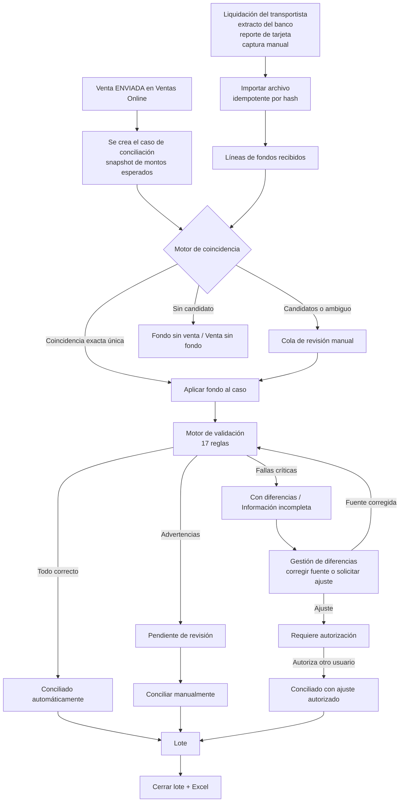
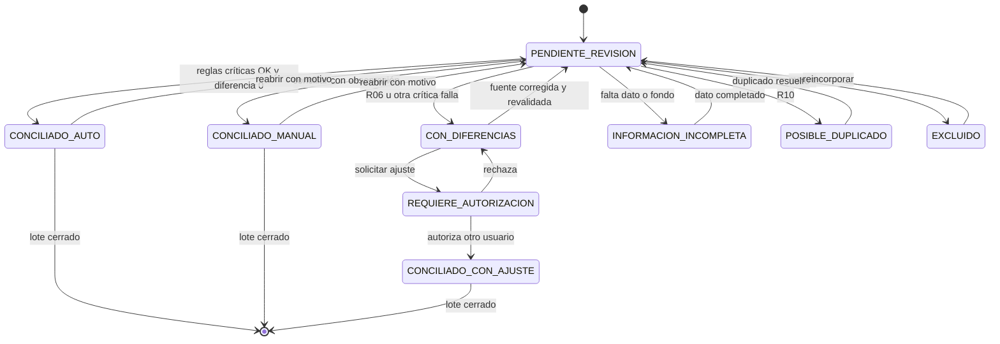
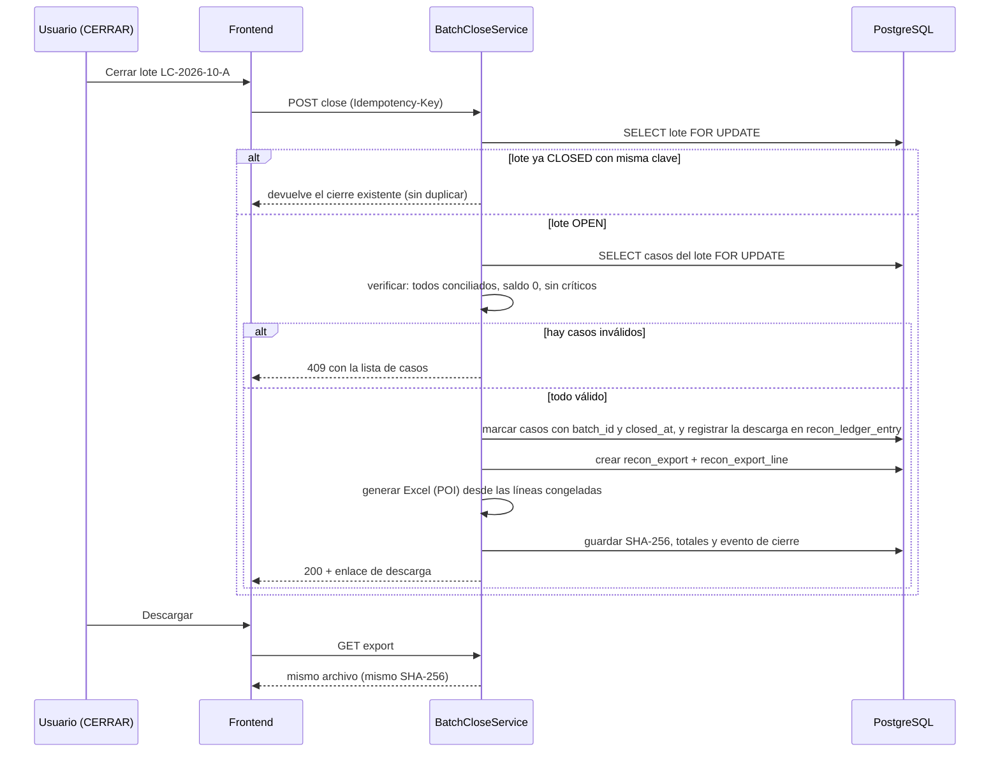
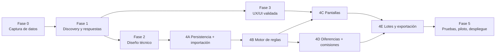

# Conciliación de ventas en línea, pagos, envíos y comisiones

**Estado:** propuesta para revisión. Actualizada el 2026-10-19 con las respuestas del negocio y la aprobación del libro de descargas propio (D13) a P1-P12 y F1, F3-F7 (ver 5.6); queda abierta solo F2 (ejemplo del proceso de Contabilidad, que no es bloqueante). No hay cambios en código de producción, migraciones ni datos financieros.
**Entregables de esta carpeta:** este plan y `prototipo/index.html` (prototipo navegable con datos ficticios).
**Evidencia usada:** código de `fossiles-core-back` y `fossiles-core-front`, y una copia local del dump de producción del 2026-10-14 (solo consultas agregadas, restaurada en un Postgres temporal que ya se eliminó). No hubo acceso a producción en vivo ni a archivos de Forza, Guatex, bancos o procesadores de tarjeta.

> Convención del documento: **[Encontrado]** existe hoy en el repo o en la base. **[Nuevo]** se propone crear. **[Modificar]** existe y habría que tocarlo. **[Supuesto]** decisión provisional que el negocio debe confirmar.

---

## 1. Resumen ejecutivo

El negocio vende en línea (Anthony Ixcajo, Eduardo Ramirez, Luisa Marquez), despacha con Forza Delivery, Guatex o un motorista propio, y el dinero llega por tres caminos distintos: el transportista cobra contra entrega y liquida después, el cliente deposita o transfiere, o paga con tarjeta/Visalink. Hoy el sistema registra la venta y el envío, pero **no registra qué dinero llegó realmente**. No existe monto recibido, fecha de pago, referencia de depósito, comisión del vendedor ni fecha de despacho.

Regla financiera principal (confirmada): **el monto cobrado debe ser exactamente igual al monto recibido**. Sin tolerancias y sin reglas distintas por método de pago. La comisión del vendedor es un control adicional que no cambia el monto esperado. Las comisiones de terceros se registran por separado y no se descuentan solas.

Hallazgo que condiciona todo el diseño: en la base real, **solo 10 de 1,654 ventas tienen número de guía (0.6%) y solo 14 tienen autorización de pago (0.8%)**. El identificador interno ENVL sí está casi completo (1,623) y no se repite. Pero Forza y Guatex no conocen el ENVL, conocen su guía. Sin captura de guía o de otra referencia que ellos devuelvan, no se puede relacionar con seguridad lo que liquidan con lo que vendimos. Por eso la Fase 0 es de captura de datos, antes de cualquier pantalla.

Propuesta: un módulo de conciliación que **no modifica `online_sale`**, crea un caso por venta/envío, registra los fondos recibidos como datos aparte (importados o capturados), aplica reglas de validación y deja en un lote cerrado e inmutable lo conciliado, con su Excel. Contabilidad hoy hace la descarga en otro sistema (SAE) y ahora debe hacerse aquí. Por eso el módulo incluye un **libro de descargas propio**, de solo agregar: cada venta genera su cargo y el cierre del lote registra la descarga que lo deja en cero. **Las ventas en línea no están en el libro de CxC de LF** y no se propone mezclarlas con él (decisión D13).

---

## 2. Hallazgos del repositorio

### 2.1 Tecnología [Encontrado]

| Capa | Hallazgo |
|---|---|
| Backend | Spring Boot 3.5.8, Java 21, Gradle, JPA/Hibernate, PostgreSQL, Caffeine, Apache POI 5.4 (Excel), JJWT, AWS S3 SDK, Sentry. Paquetes `application/{service,dto,mapper}`, `domain`, `infrastructure/{controller,persistence/{entity,repository}}`. |
| Frontend | React (Create React App) sobre plantilla **Paper Dashboard Pro**, Bootstrap 4.6 + reactstrap, react-router 6, chart.js, `xlsx` y `xlsx-js-style` para exportar. Fuente Montserrat. Rutas y permisos en `src/routes.js`. |
| Móvil | `fossiles-mobile-inventory` (Ionic/Capacitor). No participa en este módulo. |
| Base de datos | Migraciones **manuales** en `fossiles-core-back/scripts/*.sql` (correr en `fosstest` y luego en `fossilesgt` antes de desplegar). No hay Flyway. |

### 2.2 Ventas en línea [Encontrado]

- Tabla `online_sale`: **una fila por venta y por envío**. Trae cabecera y, por compatibilidad, columnas del primer producto. Las líneas reales están en `online_sale_item`.
- Montos: `net_amount` (productos), `shipping_cost` (Q30 contra entrega, Q15 el resto; editable), `total_amount = net_amount + shipping_cost`. En la base real `total_amount` coincide con `net + envío` en las 1,654 ventas.
- Identificadores: `sale_number` (correlativo del día, **no único**), `shipment_number` (ENVL, único en la práctica), `guide_number`, `payment_authorization`, `invoice_id` (FEL en `tax_invoice`), `invoice_tax_id` (NIT o CF).
- Formas de pago: `CONTRA_ENTREGA`, `CONTRA_ENTREGA_DEPOSITO`, `DEPOSITO_LISTO`, `DEPOSITO_PENDIENTE`, `TRANSFERENCIA_LISTA/PENDIENTE`, `VISALINK_PAGADO/PENDIENTE`, `TARJETA_PAGADO`.
- Transportes en uso: `FORZA_DELIVERY`, `GUATEX`, `MOTORISTA`.
- Estados: `PENDIENTE, EN_PRODUCCION, PRODUCIDO, ENVIADO, ENTREGADO, CANCELADO, DEVOLUCION, ANULADA`. En la base solo aparecen ENVIADO, DEVOLUCION, PENDIENTE, EN_PRODUCCION y ANULADA. **ENTREGADO no se usa**: "ENVIADO" significa despachado, no entregado ni cobrado.
- Devoluciones y cambios: `online_sale_return` y `online_sale_return_line`. Un cambio crea un envío a Q0 o se agrega a un envío existente (`targetOnlineSaleId`).
- Vendedor: `salesperson` es **texto libre** (3 valores reales). No hay relación con la tabla de usuarios o empleados.
- No hay cliente: solo nombre, teléfono, correo y dirección. **No existe código de cliente.**
- Servicios y endpoints reutilizables: `OnlineSaleService` (listados en lote `toResponses`), `OnlineSaleController` (`/api/online-sales`, `by-date-range`, `by-shipment`, `shipments/search`), `OnlineSalesCacheInvalidator`, `OnlineSalesDashboardService` (agrupa por vendedor).

### 2.3 Cuentas por cobrar LF [Encontrado]

- Libro `customer_account_entry`: tipos `CHARGE`, `PAYMENT`, `CREDIT_NOTE`, `CHARGE_ADJUSTMENT`, `OPENING_BALANCE`; estados `ACTIVE`/`VOID`. Anular no borra: guarda `voided_by`, `voided_at`, `void_reason`. Es el patrón de no destrucción a copiar.
- El cargo nace al despachar el envío (`docs/CUENTAS-POR-COBRAR-CARGO-POR-DESPACHO.md`), un cargo por envío, monto = cantidad enviada × precio congelado.
- **"Descarga" en el código** es el concepto de movimiento `11`: un `PAYMENT` aplicado a un cargo (`applied_to_entry_id`) con `receipt_number`, `collection_date`, `gross_collected_amount`, método y descuentos opcionales (`CustomerAccountDischargeModal`). Es **un registro de cobro contra un documento**, no un archivo que se descarga.
- Reportes: `portfolio-report` (RUTAS CxC) imprime PDF desde el navegador, sin Excel.
- Protección de doble clic: `tryBeginSingleFlight` / `createClientRequestId` en `customerAccountService.js`.
- Todo cuelga de `customer_id`. Las ventas en línea no tienen cliente, así que **no caben en este libro sin inventar identificadores**.
- **No encontré** en el repo una descarga que relacione número de envío con código de cliente. Si es un archivo o reporte externo, necesito un ejemplo (ver F2).

### 2.4 Comisiones [Encontrado]

- Ninguna tabla guarda la comisión de un vendedor en línea.
- `monthly_liquidation` existe como entidad y repositorio (`MonthlyLiquidationEntity`) con: pago real de envío, comisión Forza, comisión Guatex, faltante, IVA 12% y **tasa de comisión de vendedores 2% por defecto**, un registro por mes. **No tiene servicio, controlador ni pantalla, y la tabla está vacía en la copia.** Indica que el negocio ya pensó en este cálculo a nivel mensual, pero hoy no se usa.
- Las comisiones de kioscos (`sales_commission_pct`, `card_commission_pct` en `KioskPeriodConfigEntity`) son de otro módulo.

### 2.5 Importación, exportación y reportes [Encontrado]

- Importación de ventas: `POST /api/online-sales/import` (CSV ya pre-calculado) y `KioskExcelImportService` (kioscos).
- Exportación Excel en el front: `kioskBankDepositReportExport.js`, `kioskCashCloseReport.js`, `kioskFinancialsExport.js` y estilos en `kioskReportExcelStyle.js`. Hay un **reporte de depósitos bancarios de kioscos** con cuentas bancarias configurables (`KioskPosDepositReportProperties`) y `KioskPosDepositSlipUpdateRequest`: precedente de captura de boleta de depósito.
- POI está en el back pero la exportación del front se hace en el navegador.

### 2.6 Interfaz, permisos y auditoría [Encontrado]

- Componentes: reactstrap (`Card`, `Table`, `Modal`, `Badge`), `ReactTable`, `ConfirmModal`, SweetAlert, `DatePickerField`.
- Permisos con formato `MODULO.SUBMODULO.ACCION` (ej. `VENTAS.VENTAS_ONLINE.EDITAR`), declarados en `routes.js` y sembrados con `scripts/seed-*.sql`.
- **`@PreAuthorize` no está activo en el back.** Cada servicio llama a un guard explícito (`KioskFinancialsAccessGuard.assertCanView/Edit/Import`, ADMIN siempre pasa). Se debe seguir ese patrón.
- Auditoría: `user_activity_log` (por petición HTTP, sin valores anteriores y nuevos), columnas `created_by/updated_by`. **No hay historial campo por campo.** Para kardex de kioscos existe una tabla de solo agregar protegida por trigger (hay una trampa conocida del trigger, ver memoria del proyecto).
- Errores: `BusinessException` y `GlobalExceptionHandler`.

### 2.7 Calidad de datos medida (copia del dump 2026-10-14)

| Medición | Resultado |
|---|---|
| Ventas totales (mar-oct 2026) | 1,654; ENVIADO 1,522; DEVOLUCION 82; PENDIENTE 36; EN_PRODUCCION 12; ANULADA 2 |
| Ventas con ENVL | 1,623 (98%); **0 ENVL repetidos** |
| Ventas con **guía** | **10 (0.6%)**. Sin guía: MOTORISTA 242, GUATEX 277, FORZA 991 entre los ENVIADO |
| Ventas con **autorización de pago** | **14 (0.8%)**. Contra entrega: 0 de 1,239. Depósito listo: 10 de 225. Visalink pagado: 4 de 121. TD/TC: 0 de 23 |
| Guías y autorizaciones repetidas | 0 (pero son pocas) |
| Forma de pago | Contra entrega 1,242 (75%, incluye 3 con depósito), depósito listo 226, Visalink pagado 121, TD/TC 23, transferencia 1, pendientes de pago 41 |
| Transporte | Forza 1,090, Guatex 300, Motorista 262, vacío 2 |
| Vendedor | Anthony Ixcajo 1,434; Eduardo Ramirez 136; Luisa Marquez 84 (texto libre) |
| Ventas con factura FEL | 91 |
| `net_amount` ≠ suma de líneas | 19 ventas |
| Monto mensual | Q66k a Q168k por mes completo (abr-sep); contra entrega entre 64% y 87% del monto según el mes |
| Fecha de despacho | **No existe.** Solo `updated_at` del último cambio, promedio 4.1 días después de la venta, máximo 74 |

---

## 3. Mapa de datos disponibles y faltantes

| Dato requerido | ¿Existe? | Fuente hoy | Qué falta |
|---|---|---|---|
| Id de venta | Sí | `online_sale.id`, `sale_number` (no único) | Usar `id` como ancla técnica y ENVL como ancla de negocio |
| Factura | Parcial | `invoice_id` → `tax_invoice` (91 ventas) | Definir si la factura es obligatoria para conciliar |
| Fecha de venta | Sí | `sale_date` | |
| Monto bruto, envío, neto, total | Sí | `net_amount`, `shipping_cost`, `total_amount`, líneas | Descuentos e impuestos: no hay campo; no se asumen |
| Vendedor | Parcial | `salesperson` texto libre | Catálogo de vendedores |
| Comisión calculada o registrada | **No** | — | Tabla donde registrar el cálculo (2% sin envío); hoy es solo un cálculo |
| ENVL | Sí (98%) | `shipment_number` | |
| Guía | **No (0.6%)** | `guide_number` | Aviso al despachar sin guía (no bloquea) y recuperación histórica |
| Transportista | Sí | `shipping_carrier` | |
| Fecha de despacho o entrega | **No** | solo `updated_at` | **Aprobado (D3):** columna `dispatched_at` en `online_sale`, llenada al despachar. La de entrega vendría del transportista |
| Monto cobro contra entrega | Derivable | `total_amount` si es contra entrega | Confirmar que el transportista cobra el total con envío |
| Forma de pago | Sí | `payment_method` | |
| Monto recibido o reportado | **No** | — | Tabla nueva de fondos recibidos |
| Fecha de pago | **No** | — | Viene del archivo de la fuente |
| Referencia de depósito | **No** | — | Idem |
| Autorización del transportista | **No** | — | Viene de su liquidación |
| Autorización de ecommerce o tarjeta | Parcial (0.8%) | `payment_authorization` | Captura al registrar la venta |
| Id de transacción del proveedor | **No** | — | Liquidación del procesador |
| Comisión del medio de pago o transportista | **No** | `monthly_liquidation` (mensual, sin uso) | Por línea, desde la liquidación |
| Estado de la transacción | Parcial | `status` de la venta | |
| Resultados de validación, lote, auditoría | **No** | — | Todo nuevo |

---

## 4. Flujo operativo propuesto



Pasos:

1. **Alta de casos.** Cada venta `ENVIADO` (o `DEVOLUCION` con dinero involucrado) genera un caso al ejecutar "Preparar lote" o por un proceso programado. El caso guarda una **foto** del monto cobrado, método, transporte, guía y vendedor. Si la venta cambia después, el caso se marca "fuente modificada" y se revalida; no se sobrescribe en silencio.
2. **Ingreso de fondos recibidos.** Tres vías, empezando por la más simple:
   - captura manual por línea (sirve desde el día uno);
   - importación de Excel/CSV con mapeo de columnas por fuente (liquidación Forza, Guatex, extracto bancario, reporte de tarjeta);
   - integración directa con transportistas o bancos: **fuera de la primera versión**, no hay evidencia de que existan APIs ni credenciales.
3. **Asociación.** Reglas de la sección 5.2. Lo ambiguo nunca se asocia solo.
4. **Validación.** Se corre el motor y se guardan los resultados por regla.
5. **Resolución.** Corregir en la fuente (con su propia auditoría), registrar observación, o solicitar un ajuste que autoriza otro usuario.
6. **Cierre.** Se arma un lote con casos conciliados, se cierra y se genera el Excel dentro de la misma transacción.

---

## 5. Reglas de negocio

### 5.1 Clasificación

**Confirmadas por el usuario (2026-10-19)**

| # | Regla |
|---|---|
| C1 | El monto cobrado debe ser exactamente igual al monto recibido. Q100.00 cobrado y Q100.00 recibido: diferencia Q0.00. |
| C2 | Q100.00 cobrado y Q95.00 recibido: diferencia Q5.00. No se marca conciliado hasta resolverla o tener autorización documentada. |
| C3 | Sin tolerancias monetarias ni reglas distintas por método de pago, salvo aprobación explícita. |
| C4 | La comisión del vendedor se verifica como control adicional y no altera el monto esperado de la venta. |
| C5 | Una comisión de tercero (medio de pago o transportista) se identifica por separado y no se descuenta automáticamente. |
| C6 | Se mantienen separados: cobrado, recibido, diferencia, comisión del vendedor, comisión de tercero y saldo pendiente. |
| C7 | El saldo llega a cero solo cuando la diferencia se resolvió legítimamente. Nada de ajustes automáticos para ocultar diferencias. |
| C8 | No se modifican los datos financieros originales (`online_sale`, libro de CxC LF). La descarga se registra en el **libro propio del módulo** (C26). No se generan asientos contables hacia otros sistemas sin regla aprobada. |
| C9 | El transportista contra entrega liquida el **total** (productos + envío). Cobrado = `total_amount`. (P1) |
| C10 | La comisión del transportista y la del procesador ya se recuperan en el costo de envío que paga el cliente y **no se reflejan** en el sistema. No hay comisión de tercero que descontar ni conciliar. (P2) |
| C11 | La comisión del vendedor es **2% sobre el monto sin envío** (`net_amount`). (P3) |
| C12 | No hay pagos parciales. Un contracargo solo ocurre en un **cambio en el que el cliente debe pagar de nuevo el envío**. (P4) |
| C13 | Las liquidaciones de Forza y Guatex traen **número de guía, monto de envío y referencia del pago**. (P5) |
| C14 | Normalmente hay más envíos que pagos (cambios y devoluciones), y a veces más pagos que envíos. El modelo debe permitir ambos sentidos. (P6) |
| C15 | No hay redondeo. (P8) |
| C16 | Solo **Administración y Contabilidad** pueden proponer, autorizar y aceptar diferencias. (P9) |
| C17 | La **descarga** es dejar en cero el monto que se debía cobrar. (P10) |
| C18 | Las guías históricas **se pueden recuperar**. (P11) |
| C19 | Contabilidad quiere descargar desde este sistema y **todavía no hay nada descargado**: todas las ventas, desde la primera (marzo 2026), deben pasar por el módulo. (P12, F7) |
| C20 | Forza y Guatex generan la guía y ustedes la digitan. En el portal del transportista están los datos del cliente y el número de envío, **confirmado que es el ENVL**. Con eso las guías históricas se recuperan por asociación exacta. (F3) |
| C21 | Un cambio donde el cliente paga de nuevo el envío es muy raro y se resuelve **editando el envío del cambio** (Q30 contra entrega, Q15 en otro caso). (F4) |
| C22 | La comisión del vendedor se paga cuando ya se revisó todo el mes. No hay fecha de pago fija. Debe **quedar registrada en el sistema**; hoy solo es un cálculo. (F5) |
| C23 | No hay comisión por devoluciones. Un cambio paga comisión solo por la **diferencia contra la venta anterior**, si el cliente pidió más productos. (F5) |
| C24 | La misma persona puede proponer y autorizar una diferencia; cualquiera de Contabilidad puede hacerlo. No hay límite de monto. (F6) |
| C25 | Todo parte de cero: ni este sistema ni SAE tienen descargadas ventas en línea. El histórico completo, desde marzo 2026, se concilia y descarga en este sistema. (F7, F8) |
| C26 | Hoy Contabilidad hace la descarga en otro sistema (**SAE**). Debe pasar a hacerse **en este sistema**. (F1) |
| C27 | En SAE cada venta en línea se carga a su cliente y **cada una es una descarga** propia. En este sistema, cada caso (venta/ENVL) es su propia cuenta por descargar. (F8) |
| C28 | La descarga queda **solo en este sistema**; ya no se lleva a SAE. El libro de descargas es el único registro. (F9) |

**Confirmadas por el código (hechos)**

| # | Hecho |
|---|---|
| H1 | `total_amount = net_amount + shipping_cost`; envío Q30 contra entrega y Q15 en otro caso, editable. |
| H2 | Una venta tiene un solo ENVL. Un cambio agrega líneas a Q0 sin alterar montos. |
| H3 | "ENVIADO" es despachado. No hay estado "cobrado". |
| H4 | Las ventas en línea no están en el libro de CxC. |

**Supuestos provisionales (marcados [Supuesto], a confirmar)**

| # | Supuesto |
|---|---|
| S2 | Un caso por venta con ENVL (los cambios tienen su propio ENVL). Un fondo puede repartirse entre varios casos y un caso puede recibir varios fondos; se concilia por la suma. |
| S3 | Las ventas en `DEVOLUCION` y `ANULADA` no entran al lote normal; se listan aparte. Los **cambios** (ENVL a Q0) son casos propios; si el cliente paga de nuevo el envío, ese cobro se concilia contra ese caso (R17). |
| S6 | El histórico (1,654 ventas, desde marzo 2026) entra por tandas cronológicas (mes y transportista), con las mismas reglas que lo nuevo (ver 5.7). |

### 5.2 Estrategia de identificación

No hay código de cliente y no se inventa uno. El ancla es el **caso**, que es la venta/ENVL.

| Identificador | Confiabilidad medida | Uso |
|---|---|---|
| ENVL (`shipment_number`) | Alta: 98% presente, 0 repetidos | Ancla interna. Aparece en el portal del transportista junto a los datos del cliente (C20), por lo que sirve para recuperar las guías históricas con asociación exacta |
| Guía + transportista | Muy baja hoy (0.6%), recuperable (C18) | **Llave principal** con las liquidaciones de Forza y Guatex: ellos reportan guía, monto de envío y referencia del pago (C13) |
| Referencia del pago | Hoy casi no existe | Segunda llave de las liquidaciones, y llave con extracto bancario y reporte de tarjeta |
| `payment_authorization` | Baja hoy (0.8%) | Coincidencia exacta tarjeta/Visalink |
| Nombre, teléfono, monto, fecha | Débiles | **Solo candidatos para revisión**, nunca asociación automática |

Reglas:

- **Exacta (automática):** guía + transportista, o referencia de depósito/transacción, o autorización, o ENVL escrito en la referencia de la fuente. Debe devolver **exactamente un** caso. Si devuelve cero o más de uno, no se aplica.
- **Alternativa (propuesta, requiere confirmación humana):** mismo monto y fecha dentro de ventana, nombre o teléfono similar. Se muestran candidatos ordenados con el motivo.
- **Prohibido:** asociar por monto y fecha solamente.
- **Motorista:** no tiene guía. Se identifica por ENVL, ruta y día; el dinero llega como entrega de efectivo, capturada por quien la recibe.

### 5.3 Catálogo de reglas de validación

La severidad es configurable por regla; abajo van los valores iniciales.

| Código | Regla | Severidad inicial |
|---|---|---|
| R01 | La venta existe y su estado es conciliable (ENVIADO/ENTREGADO) | Crítico |
| R02 | ENVL presente y único | Crítico |
| R03 | Guía presente (Forza/Guatex) | Advertencia en ventas anteriores al arranque del módulo; **Crítico** en las posteriores (esto es de la conciliación; el despacho solo avisa) |
| R04 | El transportista de la venta es el de la fuente de fondos | Crítico |
| R05 | La guía y la referencia de la fuente coinciden con las de la venta | Crítico |
| R06 | **Cobrado = recibido (exacto)** | Crítico |
| R07 | La fuente corresponde a la forma de pago (contra entrega ↔ liquidación; depósito ↔ banco; tarjeta ↔ procesador) | Crítico |
| R08 | Referencia presente para depósito/tarjeta y no usada en otro caso | Crítico |
| R09 | Fechas coherentes: pago ≥ venta; despacho ≥ venta; fondo recibido ≥ despacho en contra entrega. Usa `dispatched_at` cuando existe; en ventas históricas usa `updated_at` marcada como aproximada | Advertencia |
| R10 | Sin duplicados: misma guía en dos ventas, misma línea de fondos aplicada dos veces, misma autorización en dos casos | Crítico |
| R11 | Integridad de la venta: `total = neto + envío`, `neto = suma de líneas` (hoy falla en 19 ventas) | Advertencia |
| R12 | El **monto de envío de la fuente** coincide con el envío de la venta (la liquidación lo trae); también avisa si el envío no es Q30/Q15. Sirve para explicar una falla de R06 | Advertencia |
| R13 | Comisión del vendedor: 2% del neto sin envío, **registrada en el sistema**, sin cambios tras cerrar el mes; Q0 si la venta termina en devolución; en un cambio, solo sobre la diferencia contra la venta anterior | Advertencia (no bloquea el cobro) |
| R14 | Factura FEL asociada y monto igual al cobrado | Advertencia |
| R15 | Venta en devolución con fondos aplicados (posible reembolso pendiente) | Crítico |
| R16 | Suma de fondos aplicados ≤ cobrado (no se paga de más) | Crítico |
| R17 | Cambio (ENVL a Q0) con cobro de envío del transportista y sin envío registrado: el caso muestra "cambio con cobro de envío no registrado"; se corrige editando el envío del cambio (Q30/Q15) | Crítico |

Tres niveles de resultado: **Crítico** (impide conciliar), **Advertencia** (se puede conciliar manualmente con observación) y **Aceptable con autorización** (diferencia que solo Administración o Contabilidad pueden aceptar).

### 5.4 Estados y transiciones

La conciliación tiene su estado; el cierre es una propiedad aparte (`closed_batch_id`), para que "cerrado" no se confunda con "conciliado".

| Estado | Significado | Acciones permitidas |
|---|---|---|
| `PENDIENTE_REVISION` | Caso nuevo o con advertencias | Aplicar fondo, conciliar manual, observación, excluir |
| `CONCILIADO_AUTO` | Todas las reglas críticas pasan, diferencia Q0.00 y asociación exacta | Incluir en lote, reabrir |
| `CONCILIADO_MANUAL` | Un usuario conciliado con advertencias y observación | Incluir en lote, reabrir |
| `CON_DIFERENCIAS` | Diferencia de monto o regla crítica fallando | Corregir fuente, solicitar ajuste, observación |
| `INFORMACION_INCOMPLETA` | Falta guía, referencia o fondo | Completar datos, importar fondo |
| `POSIBLE_DUPLICADO` | R10 | Resolver duplicado (anular una aplicación), observación |
| `REQUIERE_AUTORIZACION` | Hay un ajuste propuesto | Autorizar o rechazar (otro usuario) |
| `CONCILIADO_CON_AJUSTE` | Diferencia aceptada con autorización documentada | Incluir en lote (columna aparte) |
| `EXCLUIDO` | Devolución, anulada, prueba, con motivo | Reincorporar |



Un caso en lote cerrado **no se puede reabrir** salvo anulando el lote entero (acción de Administración o Contabilidad, con motivo, que deja evento permanente).

### 5.5 Cuándo el saldo es cero

`saldo_pendiente = cobrado − recibido_aplicado − ajustes_autorizados`.

- Diferencia Q0.00 con validaciones críticas OK: saldo Q0.00 (conciliado).
- Diferencia resuelta **corrigiendo el dato de origen** (por ejemplo, un monto mal capturado): la venta se edita por su flujo normal con su auditoría, se revalida y el saldo se recalcula solo.
- Diferencia aceptada con **ajuste autorizado**: queda un registro de ajuste (tipo, monto, motivo, quién propuso, quién autorizó, cuándo). El saldo del caso pasa a Q0.00 **y el ajuste se muestra por separado en pantallas y en el Excel**. No se oculta.
- Cambiar el estado a mano nunca modifica el saldo; el saldo siempre se calcula.

Este saldo vive en el **libro de descargas del módulo** (6.3). **No** toca `customer_account_entry` ni cambia `online_sale`, y no genera asientos hacia otros sistemas sin regla aprobada.

**Qué es la descarga (C17).** Es dejar en cero lo que se debía cobrar de cada venta. En este módulo, la descarga ocurre **solo** para casos con saldo calculado en Q0.00 por las reglas de arriba, y se materializa en el cierre del lote (6.7). Como Contabilidad debe hacerla en este sistema (C26), el cierre del lote registra la descarga en el libro de descargas.

### 5.6 Preguntas: respuestas y pendientes

**Respondidas (2026-10-19)**

| # | Respuesta del negocio | Efecto en el plan |
|---|---|---|
| P1 | El transportista liquida el total | C9: cobrado = `total_amount` |
| P2 | Las comisiones de transportista y procesador ya se cobran en el costo de envío y no se reflejan | C10: se quita la comisión de tercero del alcance (`third_party_fee` queda opcional y sin uso en reglas) |
| P3 | 2% sin envío | C11: base = `net_amount`, tasa 2% |
| P4 | Sin pagos parciales; contracargo solo en cambios donde se paga de nuevo el envío | C12 y regla R17 |
| P5 | Las liquidaciones traen guía, monto de envío y referencia de pago | C13: llaves de asociación y regla R12 |
| P6 | Normalmente más envíos que pagos, a veces más pagos | C14: relación muchos a muchos entre fondos y casos (ya prevista) |
| P7 | No se entendió la pregunta | Reformulada como F1 |
| P8 | Sin redondeo | C15 |
| P9 | Solo Administración y Contabilidad | C16 |
| P10 | Descarga = dejar en cero lo que se debía cobrar | C17 y sección 5.7 |
| P11 | Las guías se pueden recuperar | C18: la Fase 0 es viable |
| P12 | Contabilidad está empezando a descargar; las ventas históricas hay que procesarlas | C19 y S6; aclarado en F7: no hay nada descargado aún |
| F3 | Las guías las genera el transportista y ustedes las digitan; en su portal están los datos del cliente y el número de envío | C20: recuperación histórica por asociación exacta (confirmado: es el ENVL) |
| F4 | Muy raro; se edita el envío del cambio (mismos montos) | C21 y regla R17, sin cambios al modelo |
| F5 | Se paga cuando el mes está revisado, sin fecha fija, debe quedar registrada en el sistema; sin comisión por devolución; cambio solo por la diferencia | C22, C23, R13 y sección 5.8 |
| F6 | La misma persona puede proponer y autorizar; sin límite de monto | C24; el historial guarda siempre ambos nombres |
| F7 | De este sistema no hay nada descargado; hay que hacer todas desde la primera | C25 y sección 5.7 |
| F1 | Hoy la descarga se hace en SAE; ahora tiene que ser en este sistema | C26: se agrega un **libro de descargas** al módulo (6.3, decisión D13) |

**Pendientes (seguimiento)**

| # | Pregunta | Por qué importa |
|---|---|---|
| F2 | ¿Cómo hace Contabilidad hoy sus descargas (archivo, datos, sistema)? **Sin ejemplo por ahora.** No bloquea el diseño, pero sí la forma final del Excel | Referencia funcional; evita construir algo distinto de lo que usan |
| F8 | SAE carga cada venta a su cliente y cada una es una descarga (C27). SAE no tiene descargadas ventas en línea; todo parte de cero (C25) | Cada venta es su propia cuenta; `customer_code` queda opcional por si quieren guardar el código de SAE |
| F9 | La descarga queda solo en este sistema; no se lleva a SAE (C28) | El Excel del lote es respaldo y consulta, no un archivo de intercambio. No hay que adaptarlo al formato de SAE |

### 5.7 Descarga y datos históricos

No hay nada descargado todavía (C25): las 1,654 ventas, desde marzo 2026, pasan por el módulo.

1. **Ventas nuevas:** el despacho avisa si falta la guía de Forza o Guatex (decisión 2026-10-19: solo aviso, no bloquea); el caso se genera al despachar; descarga por lote.
2. **Histórico, por tandas cronológicas** (mes y transportista). Cada tanda:
   - recupera las guías faltantes desde el portal del transportista usando el ENVL y los datos del cliente (C20) y las carga con su fuente;
   - importa las liquidaciones del período;
   - asocia por guía + referencia de pago + monto de envío; lo que no tenga llave exacta va a revisión humana;
   - aplica las mismas 17 reglas; lo que siga sin guía queda en **Información incompleta** y no se concilia por monto y fecha;
   - se cierra como un lote más.
3. No hay descargas previas ni en este sistema ni en SAE (C25), así que no hace falta saldo inicial ni marca de "ya descargado". Todo el histórico empieza con su cargo y se descarga al cerrar su lote.

### 5.8 Comisiones del vendedor

- Cada caso conciliado genera su línea de comisión: 2% del neto sin envío (C11).
- Una devolución anula la comisión. Un cambio paga solo la diferencia contra la venta anterior (C23).
- Cuando todos los casos de un mes están conciliados o excluidos, Administración o Contabilidad ejecutan **«Cerrar comisiones del mes»**. Se congelan las líneas y se obtiene el resumen por vendedor. No hay fecha de pago (C22).
- Si después de cerrar el mes cambia la venta de origen, el sistema avisa de la diferencia; no recalcula en silencio.
- El vendedor sale del catálogo `recon_seller` (D4). Si una venta trae un nombre que no está en el catálogo, el caso muestra una advertencia y no se puede cerrar el mes hasta asignarlo.

---

## 6. Arquitectura propuesta

### 6.1 Principios

- **No tocar `online_sale` ni el libro de CxC LF.** El módulo lee de `online_sale` y guarda sus resultados y su libro de descargas en tablas propias con prefijo `recon_`. Solo habría modificaciones mínimas (6.4).
- **Historial de solo agregar** para acciones financieras.
- **Reglas en código con severidad configurable**, no un motor de reglas genérico.
- Seguir los patrones existentes: guard explícito `assertCan*`, `BusinessException`, scripts SQL manuales, permisos `VENTAS.CONCILIACION.*`.

### 6.2 Vista general

```mermaid
flowchart LR
    subgraph FE[Frontend React · Paper Dashboard]
        D[Dashboard]
        B[Bandeja + detalle]
        X[Diferencias]
        L[Lotes y descargas]
        M[Comisiones]
    end
    subgraph BE[Backend Spring Boot]
        C[ReconciliationController<br/>/api/reconciliation/*]
        G[ReconciliationAccessGuard]
        S[ReconciliationCaseService]
        I[ReceiptImportService]
        E[RuleEngine · 17 reglas]
        MT[MatchingService]
        CM[CommissionCheckService]
        BS[BatchCloseService + ExcelExporter POI]
        AU[ReconciliationEventService]
    end
    subgraph DB[(PostgreSQL)]
        OS[online_sale · item · return<br/>EXISTENTE solo lectura]
        TI[tax_invoice<br/>EXISTENTE solo lectura]
        RC[recon_case]
        RR[recon_receipt]
        RA[recon_receipt_application]
        RK[recon_check_result]
        RD[recon_difference]
        RB[recon_batch · recon_export]
        RE[recon_event append-only]
    end
    FE --> C --> G
    C --> S & I & BS & CM
    S --> E & MT & AU
    I --> MT
    S & E & MT & CM & BS --> DB
    OS -.lee.-> S
    TI -.lee.-> E
```

### 6.3 Modelo de datos propuesto [Nuevo]

```mermaid
erDiagram
    ONLINE_SALE ||--o| RECON_CASE : "1 venta = 1 caso activo"
    RECON_CASE ||--o{ RECON_RECEIPT_APPLICATION : recibe
    RECON_RECEIPT ||--o{ RECON_RECEIPT_APPLICATION : "se reparte en"
    RECON_IMPORT_FILE ||--o{ RECON_RECEIPT : contiene
    RECON_CASE ||--o{ RECON_CHECK_RESULT : valida
    RECON_CASE ||--o{ RECON_DIFFERENCE : "puede tener"
    RECON_CASE ||--o{ RECON_EVENT : audita
    RECON_BATCH ||--o{ RECON_CASE : cierra
    RECON_BATCH ||--o{ RECON_EXPORT : genera
    RECON_EXPORT ||--o{ RECON_EXPORT_LINE : "congela"
    RECON_CASE ||--o{ RECON_COMMISSION_LINE : "genera"
    RECON_CASE ||--o{ RECON_LEDGER_ENTRY : "movimientos"
    RECON_SELLER ||--o{ RECON_CASE : "vende"
    RECON_CASE {
        bigint id PK
        bigint online_sale_id UK
        string shipment_number
        string guide_number
        string carrier
        string payment_method
        string salesperson
        bigint seller_id FK "catálogo recon_seller"
        timestamp dispatched_at "foto de online_sale.dispatched_at"
        numeric expected_amount "foto de total_amount"
        numeric received_amount "suma aplicada"
        numeric difference "calculado"
        numeric authorized_adjustment
        numeric pending_balance "calculado"
        string status
        bigint batch_id FK
        timestamp source_updated_at "para detectar cambios"
        int version "bloqueo optimista"
    }
    RECON_RECEIPT {
        bigint id PK
        bigint import_file_id FK
        string source_type "CARRIER, BANK, CARD, CASH, MANUAL"
        string row_hash UK
        string carrier
        string guide_number
        string reference
        string authorization_number
        string provider_txn_id
        date received_date
        numeric amount
        numeric shipping_amount "envío que reporta la fuente"
        numeric third_party_fee "opcional, sin uso"
        jsonb raw_payload
        string status "ACTIVE, VOID"
    }
    RECON_RECEIPT_APPLICATION {
        bigint id PK
        bigint case_id FK
        bigint receipt_id FK
        numeric amount_applied
        string match_method "GUIDE, REFERENCE, AUTH, ENVL, MANUAL"
        bigint applied_by
        string status "ACTIVE, VOID"
    }
    RECON_CHECK_RESULT {
        bigint id PK
        bigint case_id FK
        string rule_code
        string severity
        string outcome "PASS, FAIL, NA"
        string expected_value
        string found_value
        string message
        string recommended_action
        bigint run_id
    }
    RECON_DIFFERENCE {
        bigint id PK
        bigint case_id FK
        string type
        numeric amount
        string status "OPEN, PROPOSED, AUTHORIZED, REJECTED, CORRECTED"
        string reason
        bigint proposed_by
        bigint authorized_by
    }
    RECON_COMMISSION_LINE {
        bigint id PK
        bigint case_id FK
        string seller
        string month "YYYY-MM"
        numeric base_amount "neto sin envío"
        numeric rate "2%"
        numeric commission_amount
        string status "CALCULADA, ANULADA_DEVOLUCION, CONGELADA"
        timestamp locked_at "al cerrar el mes"
        bigint locked_by
    }
    RECON_BATCH {
        bigint id PK
        string code UK
        date period_from
        date period_to
        string status "OPEN, CLOSED, VOID"
        string idempotency_key UK
        bigint closed_by
        timestamp closed_at
        numeric total_expected
        numeric total_received
        numeric total_adjusted
    }
    RECON_EXPORT {
        bigint id PK
        bigint batch_id FK
        string file_sha256
        int row_count
        bigint created_by
        timestamp created_at
    }
    RECON_EXPORT_LINE {
        bigint export_id FK
        bigint case_id FK
    }
    RECON_SELLER {
        bigint id PK
        string name UK "igual a online_sale.salesperson"
        boolean active
        bigint user_id "opcional"
    }
    RECON_LEDGER_ENTRY {
        bigint id PK
        string customer_code "opcional: código del cliente en SAE"
        bigint case_id FK
        bigint batch_id FK "vacío en el cargo"
        string entry_type "CARGO, DESCARGA, AJUSTE_AUTORIZADO, REVERSA"
        numeric amount
        bigint reverses_entry_id "solo en reversas"
        string idempotency_key UK
        timestamp at
        bigint by_user
    }
    RECON_EVENT {
        bigint id PK
        bigint case_id
        string event_type
        string from_status
        string to_status
        jsonb payload
        bigint actor_id
        timestamp at
    }
    RECON_IMPORT_FILE {
        bigint id PK
        string file_name
        string sha256 UK
        string source_type
        int rows_total
        int rows_matched
        bigint imported_by
    }
```



Notas de diseño:

- `received_amount`, `difference` y `pending_balance` **se recalculan siempre** desde las aplicaciones y ajustes; no se editan a mano.
- `recon_ledger_entry` es el **libro de descargas**, de solo agregar (con trigger, igual que `recon_event`). El cargo nace al despacharse la venta (monto cobrado); la descarga se registra al cerrar el lote por lo recibido; el ajuste autorizado va como movimiento aparte; anular un lote crea **reversas** y nunca borra. Saldo de un caso = cargo − descarga − ajuste + reversas. Cada caso (venta/ENVL) es su propia cuenta, como en SAE (C27): el saldo de una venta es su cargo menos su descarga. No se agrupa por cliente porque no hay código de cliente.
- `recon_receipt_application` permite pagos parciales y un fondo repartido entre varias ventas (una liquidación de Forza paga muchas guías).
- `recon_commission_line` guarda la comisión calculada por caso y se **congela** al cerrar el mes (C22). No hay comisión "registrada" externa que comparar. En devolución la línea pasa a `ANULADA_DEVOLUCION` con monto 0; en un cambio con productos extra la base es la diferencia contra la venta anterior (C23).
- `recon_event` lleva un trigger que impide `UPDATE` y `DELETE`. Ojo con la trampa del trigger append-only ya vivida en kiosco (ver nota del proyecto).
- `recon_receipt.third_party_fee` queda opcional y sin uso en las reglas: el negocio confirmó que esas comisiones no se reflejan (C10). La diferencia se calcula siempre con el monto recibido tal como viene (C5). Se agrega `recon_receipt.shipping_amount` (envío que reporta la liquidación, C13) para la regla R12.

### 6.4 Reutilizar, modificar, crear

| Tipo | Elemento |
|---|---|
| **Reutilizar** | `online_sale`, `online_sale_item`, `online_sale_return` (lectura); `tax_invoice`; `OnlineSaleService.toResponses` (carga en lote); patrón de guard `assertCan*`; `BusinessException`/`GlobalExceptionHandler`; `SecurityUtil.getCurrentUserId`; POI; `user_activity_log`; `ReactTable`, reactstrap, `ConfirmModal`; `xlsx-js-style` y estilos de `kioskReportExcelStyle.js`; patrón de anulación no destructiva de CxC; `createClientRequestId`/single-flight; patrón de seed de permisos |
| **Modificar** (aprobado) | (a) `routes.js` y menú: nueva entrada bajo VENTAS. (b) Flujo de despacho (`CustomerShipmentDispatchService`, sus dos puntos que fijan `ENVIADO`): avisar cuando falta la guía de Forza/Guatex, sin bloquear el despacho (Fase 0, hecho). (c) **D3 aprobado:** columna `dispatched_at` en `online_sale` (acepta vacío, sin valor por defecto), llenada en esos dos puntos; rollback con `DROP COLUMN`. (d) **D4 aprobado:** el catálogo de vendedores vive en el módulo (`recon_seller`), sin cambiar `online_sale.salesperson`. (e) `OnlineSalesCacheInvalidator`: sin cambios si el módulo no escribe ventas |
| **Crear** | Tablas `recon_*` (incluye el libro de descargas `recon_ledger_entry`) y script `migration-reconciliation.sql` con su rollback; permisos `VENTAS.CONCILIACION.*` con `seed-reconciliation-permissions.sql`; paquete `reconciliation` con controlador, servicios, motor de reglas, importador, exportador; 5 pantallas y servicio front `reconciliationService.js` |

### 6.5 API propuesta [Nuevo]

| Método | Ruta | Uso | Permiso |
|---|---|---|---|
| GET | `/api/reconciliation/dashboard` | KPIs con filtros | VER |
| GET | `/api/reconciliation/cases` | Bandeja con filtros, orden y paginación (servidor) | VER |
| GET | `/api/reconciliation/cases/{id}` | Detalle, validaciones, historial | VER |
| POST | `/api/reconciliation/cases/generate` | Crear casos de un período (idempotente) | CONCILIAR |
| POST | `/api/reconciliation/cases/{id}/revalidate` | Correr reglas | CONCILIAR |
| POST | `/api/reconciliation/cases/{id}/reconcile` | Conciliar manual con observación | CONCILIAR |
| POST | `/api/reconciliation/cases/bulk-reconcile` | Solo casos `CONCILIADO_AUTO` sin advertencias | CONCILIAR |
| POST | `/api/reconciliation/receipts/import` | Subir archivo (idempotente por SHA-256) | IMPORTAR |
| POST | `/api/reconciliation/receipts` | Captura manual | IMPORTAR |
| POST | `/api/reconciliation/cases/{id}/apply-receipt` | Aplicar fondo a caso | CONCILIAR |
| POST | `/api/reconciliation/applications/{id}/void` | Anular aplicación | CONCILIAR |
| POST | `/api/reconciliation/cases/{id}/differences` | Proponer ajuste | AJUSTAR |
| POST | `/api/reconciliation/differences/{id}/authorize` | Autorizar o rechazar | AUTORIZAR |
| GET | `/api/reconciliation/commissions` | Revisión por vendedor | COMISIONES |
| POST | `/api/reconciliation/commissions/close-month` | Congela las comisiones de un mes ya conciliado | COMISIONES |
| POST | `/api/reconciliation/batches` | Crear lote desde casos conciliados | CERRAR |
| POST | `/api/reconciliation/batches/{id}/close` | Cerrar y generar Excel (con `Idempotency-Key`) | CERRAR |
| GET | `/api/reconciliation/batches/{id}/export` | Descargar el mismo archivo ya generado | VER |
| POST | `/api/reconciliation/batches/{id}/void` | Anular lote con motivo | AUTORIZAR |

### 6.6 Permisos

`VENTAS.CONCILIACION.VER`, `.CONCILIAR`, `.IMPORTAR`, `.AJUSTAR` (proponer), `.AUTORIZAR`, `.CERRAR`, `.COMISIONES`. Por C16 y C24: proponer ajustes, autorizar, cerrar e importar fondos quedan limitados a **Administración y Contabilidad**; la misma persona puede proponer y autorizar y no hay límite de monto. Por eso el historial guarda siempre quién propuso y quién autorizó, y la hoja de ajustes del Excel muestra ambos nombres. Consultar puede abrirse a más roles si el negocio lo pide.

### 6.7 Cierre y exportación



Excel (una hoja por tema, formato `xlsx` por ser lo que ya usa el equipo):

- **Resumen:** lote, período, usuario y fecha de cierre, SHA-256, conteos y totales cobrado/recibido/ajustado, totales por método de pago y por transportista, y la **conciliación contra el sistema**: casos exportados = casos cerrados (debe coincidir; si no, no se cierra).
- **Detalle:** fecha, venta, ENVL, guía, transportista, método de pago, referencia/autorización, cobrado, recibido, diferencia, ajuste autorizado, comisión de tercero, comisión del vendedor esperada y registrada, vendedor, estado, usuario que concilió y fecha.
- **Ajustes autorizados:** quién propuso, quién autorizó, motivo.
- **Comisiones por vendedor.**

Anti-duplicados: un caso solo puede pertenecer a un lote cerrado (índice único parcial), el cierre es idempotente y la descarga repite el archivo congelado, no lo regenera con datos nuevos.

El cierre registra la **descarga en el libro**: un movimiento por caso, con llave de idempotencia por caso y lote, de modo que repetir el cierre no duplica movimientos. El Excel es el respaldo, no el registro. Anular un lote crea reversas con motivo y nunca borra movimientos.

### 6.8 Auditoría, errores, concurrencia

- **`recon_event`** guarda cada acción (generar, aplicar fondo, anular, conciliar, proponer, autorizar, cerrar, anular lote) con usuario, hora, estado anterior y nuevo, y un JSON de lo que cambió.
- **Trazabilidad:** `raw_payload` conserva la fila original del archivo; `recon_check_result` conserva valor esperado y encontrado de cada regla; el caso guarda la foto de origen.
- **Concurrencia:** columna `version` (bloqueo optimista) en el caso; `SELECT … FOR UPDATE` al cerrar; llaves únicas (`recon_receipt.row_hash`, `recon_import_file.sha256`, `recon_case.online_sale_id` activo, `recon_batch.idempotency_key`).
- **Errores:** mensajes accionables ("La guía 58755454577 aparece en 2 ventas: ENVL-01201 y ENVL-01388"); importación por filas con reporte de rechazadas, sin perder las buenas.
- **Reintentos:** importar el mismo archivo devuelve el resultado previo; cerrar dos veces devuelve el cierre existente.

### 6.9 Pruebas

- **Unitarias:** cada regla con casos límite (Q100.00 vs Q99.99, centavos, múltiples fondos), cálculo de saldo, transiciones de estado, hash de filas.
- **Integración:** importación idempotente, asociación exacta vs ambigua, cierre concurrente (dos hilos), trigger de solo agregar, exportación con totales.
- **Aceptación:** con casos reales anonimizados de la copia: un lote del mes, contra entrega de Forza, un depósito, una tarjeta, una devolución, una diferencia de Q5.00 y su ajuste autorizado.
- Correr con `gradlew test --offline` (hay 39-43 fallos previos ajenos en la suite completa; comparar contra esa línea base).

---

## 7. Diseño UX/UI

Prototipo navegable: [`prototipo/index.html`](prototipo/index.html). Todos los datos son **ficticios** y están marcados en pantalla; no se conecta a ningún endpoint. Reutiliza el lenguaje de Paper Dashboard (fondo `#f4f3ef`, turquesa `#51cbce`, Montserrat, tarjetas blancas, badges con borde).

Principios aplicados: diferencias visibles por **icono, texto y signo**, no solo color; el detalle se abre en panel lateral para no perder la tabla; filtros que persisten en `localStorage` por usuario; teclado `J/K` para moverse, `Enter` abre, `C` concilia, `/` busca.

| # | Pantalla | Usuario | Objetivo | Decisión |
|---|---|---|---|---|
| 1 | Dashboard | Jefe/administración | Ver de un vistazo qué falta | KPIs desde `GET /dashboard`; cada tarjeta lleva a la bandeja ya filtrada |
| 2 | Bandeja | Auxiliar de conciliación | Revisar cientos de casos | Tabla de 12 columnas, paginación del servidor, selección para acciones masivas seguras |
| 3 | Detalle | Auxiliar | Entender qué coincide y qué no | Panel lateral y ruta propia; secciones Venta, Envío, Pago, Comisión, Validaciones, Historial |
| 4 | Diferencias | Auxiliar y autorizador | Resolver excepciones | **Vista de la misma bandeja** agrupada por tipo, con cola de autorización; no es un módulo aparte |
| 5 | Lotes y descargas | Contabilidad | Cerrar y exportar | Lista de lotes, totales, historial de descargas, advertencia de duplicados |
| 6 | Comisiones | Administración y Contabilidad | Calcular, revisar y cerrar la comisión mensual por vendedor | Pantalla propia porque agrega por vendedor y mes, distinto de la vista por caso |

### Estados por pantalla

| Pantalla | Carga | Vacío | Error | Éxito |
|---|---|---|---|---|
| Dashboard | Tarjetas esqueleto | "Aún no hay casos. Genere casos del período" con botón | Banner con reintento, tarjetas en gris | Cifras |
| Bandeja | Filas esqueleto | Explica los 3 pasos (generar, importar fondos, revisar) | Mensaje con causa y reintento | Toast "N casos conciliados" |
| Detalle | Secciones esqueleto | n/a | Si el caso cambió: "Otro usuario lo modificó", recargar | Toast y el estado cambia |
| Diferencias | Esqueleto | "Sin diferencias abiertas" | Igual que bandeja | |
| Lotes | Esqueleto | "No hay lotes. Cree uno desde casos conciliados" | Si el cierre falla muestra la lista de casos inválidos | "Lote cerrado, 214 casos, archivo listo" |
| Comisiones | Esqueleto | Pide elegir vendedor y período | Aviso si falta tasa configurada | |

### Responsive y accesibilidad

- Tablas con scroll horizontal dentro de su contenedor; en teléfono la bandeja pasa a tarjetas con ENVL, monto, diferencia y estado.
- Contraste mínimo AA, foco visible, estados siempre con texto, importes alineados con cifras tabulares, nunca solo rojo/verde.
- Confirmación solo en acciones irreversibles (cerrar lote, autorizar ajuste, anular lote). Conciliar y aplicar fondo son reversibles y no piden confirmación.

### Prompts para herramienta de diseño (si usan Stitch u otra)

No encontré Stitch ni una herramienta de diseño conectada a este proyecto; por eso el prototipo es HTML. Si lo quieren generar allí, estos prompts mantienen la consistencia:

- **Base común:** "Dashboard administrativo en español (Guatemala), estilo Paper Dashboard: fondo #f4f3ef, tarjetas blancas sin sombra fuerte, acento turquesa #51cbce, éxito #6bd098, alerta #fbc658, peligro #ef8157, tipografía Montserrat, moneda Q con dos decimales y cifras tabulares, tablas densas, sin emojis."
- **Bandeja:** "Tabla de conciliación con 12 columnas (fecha, pedido, ENVL, guía, transportista, método de pago, referencia, esperado, recibido, diferencia con icono y signo, vendedor, estado en badge). Barra de búsqueda y filtros arriba, selección con casillas y barra de acciones masivas, panel de detalle que se desliza a la derecha."
- **Detalle:** "Panel con secciones Venta, Envío, Pago, Comisión, Validaciones e Historial. En Validaciones cada fila muestra valor esperado, valor encontrado, diferencia, fuente, motivo y acción recomendada."
- **Diferencias:** "Lista agrupada por tipo de problema con contadores, prioridad por monto y antigüedad, y cola de autorización con motivo obligatorio."
- **Lotes:** "Tabla de lotes con totales esperados, recibidos, conciliados y pendientes, historial de descargas y banner que advierte operaciones ya incluidas en una descarga previa."
- **Comisiones:** "Tabla por vendedor y mes con base (neto sin envío), tasa 2%, comisión calculada, anuladas por devolución, estado abierto o cerrado y botón Cerrar comisiones del mes."

---

## 8. Riesgos y decisiones que requieren aprobación

| # | Riesgo o decisión | Impacto | Propuesta |
|---|---|---|---|
| D1 | **Guía casi nunca capturada (0.6%)** | Sin guía no hay asociación exacta con Forza/Guatex | Fase 0: recuperar guías históricas (C18, F3) y avisar al despachar sin guía (solo aviso, hecho) |
| D2 | **No hay fuente de "monto recibido"** | El módulo queda vacío sin archivos | Pedir muestras de liquidación Forza, Guatex, extracto bancario y reporte de tarjeta antes de cerrar el diseño de importación |
| D3 | ~~Sin fecha de despacho~~ | **Aprobado (2026-10-19):** agregar `dispatched_at` | Columna nueva que acepta vacío en `online_sale`, llenada en los dos puntos de despacho. Ventas históricas con `updated_at` marcada como aproximada. Es el único cambio al flujo existente además de exigir la guía |
| D4 | ~~Vendedor en texto libre~~ | **Aprobado (2026-10-19):** opción A, catálogo propio en el módulo | Tabla `recon_seller` ligada a `online_sale.salesperson` por nombre exacto. Un nombre fuera del catálogo da advertencia en el caso y **bloquea el cierre de comisiones del mes** hasta asignarlo. Migrar a llave real (opción B) queda para después si el negocio lo pide |
| D5 | ~~Base de la comisión~~ | Resuelto: 2% sin envío (C11, C22, C23) | Sin acción |
| D6 | ~~Comisión de tercero~~ | Resuelto: no se refleja (C10) | Se quita del alcance |
| D7 | Histórico sin guía ni referencias | 1,654 ventas por conciliar desde cero | 5.7: tandas cronológicas, asociación exacta o revisión humana |
| D8 | 19 ventas con neto ≠ líneas | R11 fallará en datos viejos | Mostrar como advertencia y corregir en el origen |
| D9 | ~~Cambios que cobran de nuevo el envío~~ | Resuelto: se edita el envío del cambio (C21) | R17 avisa si falta |
| D10 | Cierre y reapertura | Un error en lote cerrado no se puede editar | Solo anulación de lote por Administración o Contabilidad, con evento permanente |
| D11 | Migración | Tablas nuevas, trigger | Script con rollback, correr en `fosstest` y luego `fossilesgt` **antes** de desplegar; sin tocar tablas existentes |
| D12 | Rendimiento | Miles de casos | Paginación del servidor, índices por estado/fecha/ENVL/guía; evaluar caché Caffeine como en ventas en línea solo si hace falta |
| D13 | **Libro de descargas propio o reutilizar CxC LF** | CxC LF exige `customer_id` y su lógica es de LF (servicio de más de 3,000 líneas, cargos por envío de producción) | Recomiendo libro propio en el módulo, con cada venta como su propia cuenta, y reutilizar solo el patrón de anulación y los reportes. **Aprobado por el usuario (2026-10-19)** |
| D14 | ~~Transición desde SAE~~ | Resuelto: SAE no tiene descargas de ventas en línea (C25) | Sin acción. Sin acción (F9: la descarga queda solo aquí) |
| D15 | Código de cliente en la descarga | SAE carga cada venta a su cliente; aquí no hay código de cliente | Cada caso (ENVL) es su propia cuenta; `customer_code` opcional para guardar el código de SAE si lo necesitan. No se inventa un código. Confirmar con F8 |
| D16 | El libro de descargas es el **único registro** (C28) | No hay otro sistema contra el cual contrastar | Libro de solo agregar con trigger, reversas con motivo, auditoría de cada movimiento, respaldo de la base antes de la primera tanda histórica y pruebas de saldo (cargos − descargas = saldo) por caso y por lote |

---

## 9. Plan de implementación



**Fase 0, captura de datos (puede empezar ya, no depende del módulo)**
- Recuperar guías históricas desde el portal de Forza y Guatex con el ENVL y los datos del cliente (C20) y cargarlas con su fuente. Criterio: porcentaje de ventas ENVIADO de Forza/Guatex con guía, medido antes y después.
- Aviso al despachar sin guía Forza/Guatex (hecho; no bloquea). Criterio de seguimiento: 95% de los envíos nuevos con guía en 2 semanas, medido con la consulta de auditoría.
- Obtener muestras reales de la liquidación de Forza, de Guatex, del extracto bancario y del reporte de tarjeta (traen guía, monto de envío y referencia).

**Fase 1, discovery.** P1-P12, F1 y F3-F9 respondidas; D3, D4 y D13 aprobadas. Queda F2 (ejemplo del proceso de Contabilidad, no bloqueante) y revisar las muestras reales de las fuentes. Criterio: reglas confirmadas por escrito.

**Fase 2, diseño funcional y técnico.** Contratos de API finales, script SQL con rollback, matriz de permisos. Criterio: revisión aprobada del modelo de datos.

**Fase 3, UX/UI.** Validar el prototipo con quien concilia, medir clics por operación (meta: ≤ 3 para un caso limpio). Criterio: flujo aprobado por usuarios operativos.

**Fase 4, implementación incremental**

| Sub-fase | Contenido | Criterio de aceptación |
|---|---|---|
| 4A | Tablas (incluye `recon_seller`), columna `dispatched_at`, generación de casos, captura manual e importación de fondos | Importar el mismo archivo dos veces no duplica; cada caso tiene identificación trazable |
| 4B | Motor de reglas R01-R17 y estados | Q100.00 vs Q95.00 da `CON_DIFERENCIAS` con Q5.00 visible; coincidencia ambigua va a revisión |
| 4C | Dashboard, bandeja, detalle | KPIs coinciden con consulta SQL directa; filtros persisten |
| 4D | Diferencias, autorización, comisiones y cierre mensual | Se registra quién propuso y quién autorizó; saldo solo llega a cero por resolución legítima; la comisión se congela al cerrar el mes |
| 4E | Lotes, cierre, descarga en el libro y Excel | Excel = casos cerrados; repetir el cierre no duplica movimientos; el saldo de cada venta baja exactamente lo descargado; la descarga repite el mismo SHA-256 |

**Fase 5, pruebas y despliegue.** Pruebas con casos reales anonimizados, concurrencia, piloto de un período con el equipo, plan de reversión (rollback del esquema; el módulo no escribe en tablas existentes, así que desactivar el menú basta para volver atrás).

---

## 10. Criterios de aceptación (trazabilidad)

| Criterio | Cómo se cumple |
|---|---|
| Cada operación tiene identificación trazable | Caso ligado a `online_sale.id` + ENVL + foto de origen |
| Coincidencias automáticas verificables | Solo por identificador exacto y único; se guarda `match_method` |
| Ambiguas a revisión | Cero o varios candidatos nunca aplican |
| Diferencias visibles y explicables | `recon_check_result` con esperado, encontrado, motivo, acción |
| Comisiones con base definida | `recon_commission_line` guarda base (neto sin envío), tasa 2% y monto; se congela al cerrar el mes |
| Conciliados no se procesan dos veces | Índice único de caso en lote cerrado + cierre idempotente |
| Descargas reflejan lo incluido | `recon_export_line` congela los casos; resumen compara contra cerrados |
| Saldos solo se cierran por regla | Saldo calculado, no editable; ajustes separados y autorizados |
| Cambios auditados | `recon_event` solo-agregar con trigger |
| Localizar problemas rápido | Búsqueda por ENVL/guía/referencia, filtros combinables, vista de diferencias |
| Revisar grandes cantidades | Paginación servidor, atajos, acciones masivas seguras |
| No romper lo existente | Sin cambios a `online_sale`/CxC; cambios menores acotados a 6.4 |

---

## 11. Qué sigue

1. Revisar este plan y el prototipo con el responsable del negocio y con quien concilia hoy.
2. Compartir muestras reales de la liquidación de Forza, de Guatex, del extracto bancario y del reporte de tarjeta, y un ejemplo del proceso de descarga de Contabilidad (F2) cuando lo tengan.
3. Conseguir muestras reales de las liquidaciones, extracto y reporte de tarjeta (D2) y arrancar la Fase 0.
4. Con eso, cerrar el modelo de datos y recién ahí escribir migraciones y código.

---

## 12. Estado de la implementación

Rama `feature/conciliacion-fase0` desde `origin/main` en `fossiles-core-back` y `fossiles-core-front`. **Sin commit, sin push, sin despliegue, sin ejecutar nada contra `fosstest` ni `fossilesgt`.** Las fases 0 a 4E están construidas; falta validarlas con archivos reales de las fuentes (ver 12.4).

### 12.1 Qué existe

| Fase | Pieza | Dónde |
|---|---|---|
| 0 | Fecha de despacho `dispatched_at` y aviso (no bloqueo) si falta la guía de Forza o Guatex | `CustomerShipmentDispatchService.markDispatched`, `OnlineSaleEntity`, `DispatchModal.js` |
| 0 | Consulta de ventas despachadas sin guía | `scripts/audit-online-sales-missing-guide.sql` |
| 0 | Importar guías históricas (ENVL + guía): solo llena las que faltan, con vista previa | `ReconciliationGuideImportService`, menú Herramientas |
| 4A | 13 tablas `recon_*` con restricciones, índices y triggers de solo agregar | `scripts/migration-reconciliation-base.sql` y su rollback |
| 4A | Generar casos desde ventas (idempotente, cargo en el libro) | `ReconciliationCaseService.generate` |
| 4A | Importar Excel/CSV de fondos (idempotente por archivo y por fila), captura manual, aplicar y anular | `ReconciliationReceiptService`, `ReconciliationFileParser` |
| 4A | Asociación solo por identificador exacto y único (guía, referencia, ENVL); monto y fecha solo dan candidatos | `ReconciliationMatcher` |
| 4B | 17 reglas R01-R17 y resolución de estado | `ReconciliationRuleEngine`, `ReconciliationStatusResolver` |
| 4C | Dashboard, bandeja (filtros, orden, búsqueda rápida, paginación, selección segura, atajos), detalle | `ReconciliationPage` y `components/reconciliation/` |
| 4D | Diferencias, ajuste de faltantes con motivo y autorización, fondos sin venta con candidatos | `ReconciliationDifferenceService`, pestaña Diferencias |
| 4D | Comisión 2% sin envío, cálculo, cierre mensual, catálogo de vendedores | `ReconciliationCommissionService`, `ReconciliationSellerService` |
| 4E | Lotes: crear, cerrar (libro + Excel + huella), anular con reversas, descarga repetible | `ReconciliationBatchService`, `ReconciliationExcelExporter`, `ReconciliationLedgerService` |
| 4E | Permisos `VENTAS.CONCILIACION.*` | `ReconciliationAccessGuard`, `scripts/seed-reconciliation-permissions.sql` |

API: `/api/reconciliation/*` (controlador `ReconciliationController`). Ruta del front: `/admin/online-reconciliation`.

Decisiones tomadas al construir, que conviene que el negocio conozca:

- Solo se ajusta un **faltante**. Un sobrante no se acepta con ajuste: se corrige el dato o se anula la aplicación.
- Un ajuste autorizado resuelve únicamente la regla del monto. Si hay otra falla crítica, el caso sigue con diferencias.
- Un vendedor fuera del catálogo da una advertencia en el caso (queda en revisión) y bloquea el cierre de comisiones del mes.
- Los resultados de las reglas se calculan al abrir un caso y se **guardan como foto al cerrar el lote**.
- Excluir un caso revierte su cargo en el libro; reincorporarlo lo vuelve a cargar.
- El monto de una venta que cambia después de crear el caso no se actualiza solo: hay una acción explícita que revierte el cargo anterior y registra uno nuevo.
- La huella SHA-256 del lote es del contenido de las filas, no de los bytes del xlsx (que cambian con la fecha de creación).

### 12.2 Cómo se verificó

| Qué | Resultado |
|---|---|
| Pruebas del backend de lo construido | 78 pasan: reglas (24), flujo completo en Hibernate+H2 (14), lector de archivos (7), asociación (7), despacho (8), controlador (7), permisos (3), invalidación de caché (8) |
| Flujo completo | Generar → importar → asociar → ajustar → lote → cerrar → Excel → anular → comisiones. Verifica saldo cero en el libro, cerrar dos veces sin duplicar, y que un caso cerrado no se modifica |
| Esquema en Postgres 18 (copia local del dump) | Las 15 entidades validan con Hibernate `validate`; la validación falla si falta una columna (se comprobó). Los triggers rechazan `UPDATE`, `DELETE` y `TRUNCATE`; el rollback se niega si hay historial |
| Rendimiento (1,700 ventas, H2 en memoria) | Generar casos 2.2 s, importar 1,700 filas 1.5 s, dashboard 0.3 s, bandeja 0.05 s, cerrar un lote de 850 casos 6.5 s |
| Pruebas del frontend | 14 del helper y 6 de interfaz (dashboard, bandeja con diferencia con signo y texto, detalle sin perder la tabla, ajuste exige motivo, sin permisos todo deshabilitado, cierre de lote con confirmación e idempotencia) |

Las pruebas del front se corrieron con una configuración de Jest aparte porque el Jest del proyecto no arranca en este equipo (Babel 7.18). No se levantó la app en un navegador.

### 12.3 Orden de despliegue

1. **Respaldo** de `fossilesgt`.
2. Correr `migration-online-sale-dispatched-at.sql` y `migration-reconciliation-base.sql` en `fosstest` y luego en `fossilesgt`, **antes** de desplegar el back (con `ddl-auto=validate` el back no arranca si falta una columna o tabla).
3. Correr `seed-reconciliation-permissions.sql` y asignar los permisos solo a Administración y Contabilidad (CONCILIAR, IMPORTAR, AJUSTAR, AUTORIZAR, CERRAR, COMISIONES); VER puede abrirse a más roles.
4. Desplegar back y front.
5. En `fosstest`, con una copia reciente: generar casos de un mes, importar una liquidación real y recorrer el flujo antes de tocar producción.
6. Correr `audit-online-sales-missing-guide.sql`, recuperar las guías del portal e importarlas desde Herramientas.

Rollback: `rollback-reconciliation-base.sql` (se niega a borrar si ya hay movimientos en el libro o eventos) y `rollback-online-sale-dispatched-at.sql`. Desactivar el permiso `VER` oculta el módulo sin tocar nada más.

### 12.4 Lo que falta o hay que vigilar

- **Archivos reales de las fuentes.** El lector reconoce las columnas por nombre (guía, monto, monto de envío, referencia, autorización, fecha, transportista, ENVL), pero no se ha visto una liquidación de Forza ni de Guatex ni un extracto. Si un formato trae otros nombres, hay que agregar el alias en `ReconciliationFileParser`. Es la primera prueba a hacer con datos reales.
- **Ejecutar el flujo en `fosstest`** con datos reales antes de producción (12.3, paso 5).
- **Historial de movimientos** de las ventas históricas: el libro nace en cero; el primer cargo de cada venta se registra al generar sus casos.
- **Nombres de usuario** en el historial salen de `username`; si un usuario no existe, se muestra su número.
- **Pantallas no vistas en un navegador.** Se verificaron con pruebas de render, no a ojo.
- **No incluido:** integración automática con transportistas o bancos (no hay APIs ni credenciales), formato de intercambio con SAE (se decidió que la descarga queda solo en este sistema), asientos contables hacia otros sistemas.
